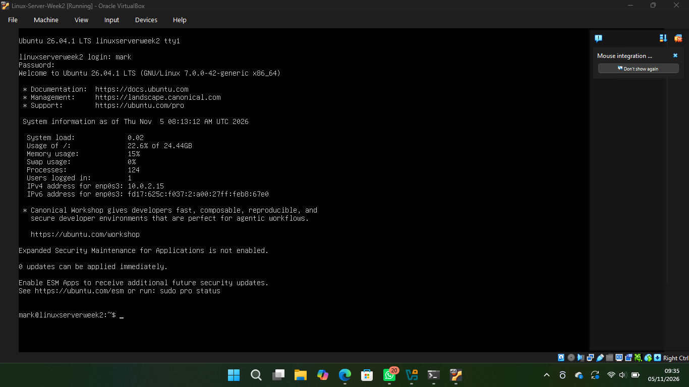
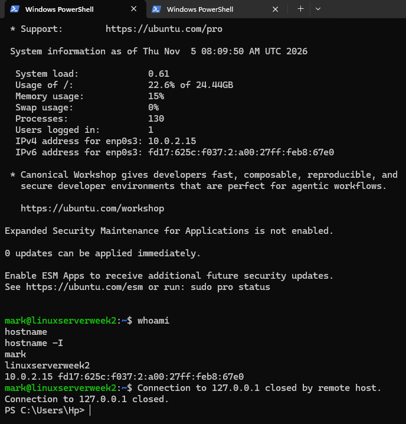
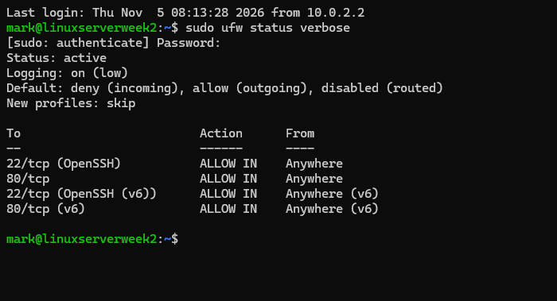
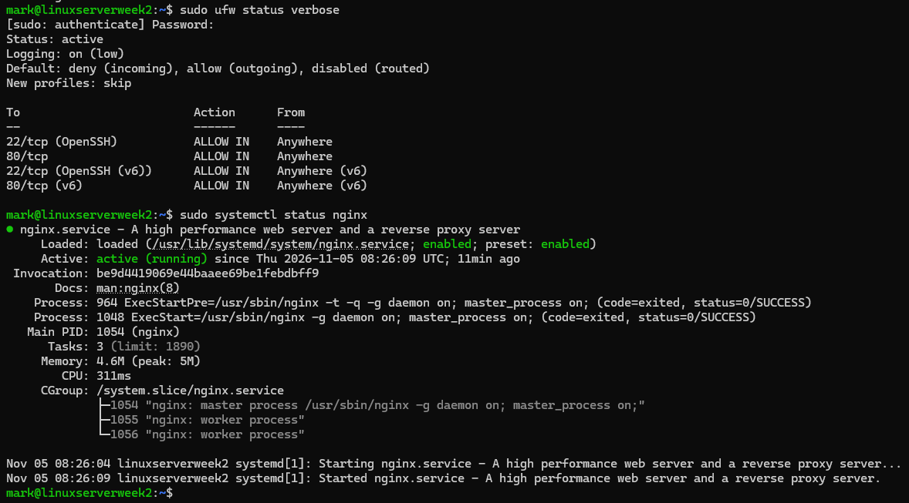
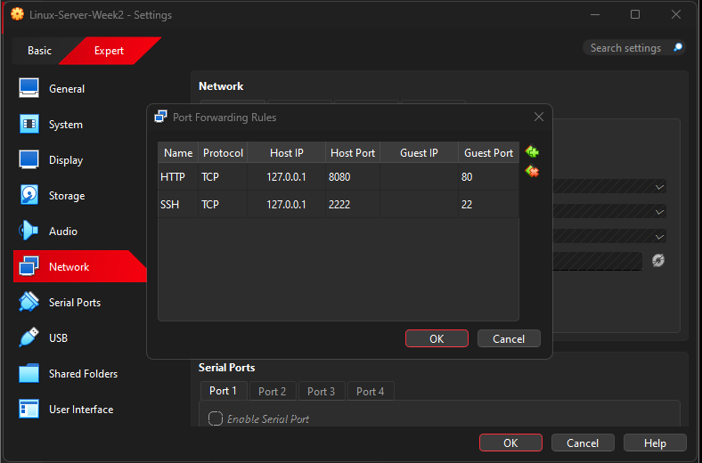
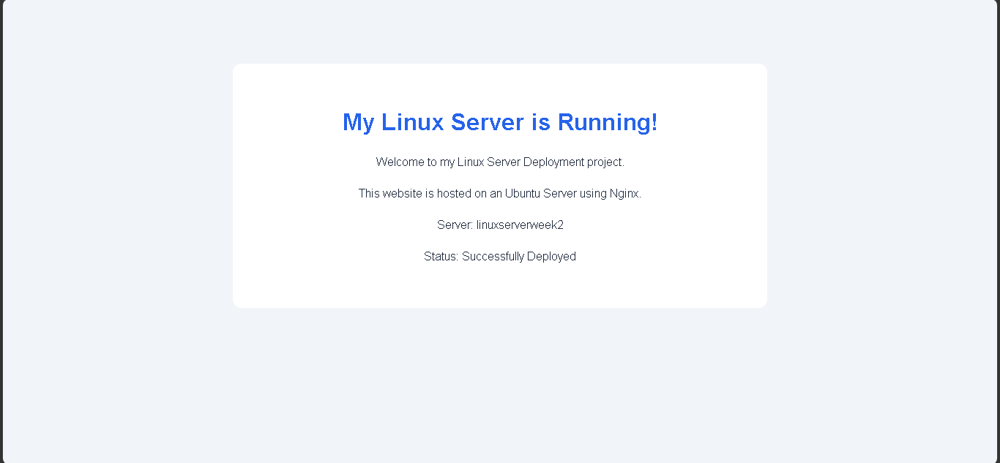

# Linux Server Deployment

<p align="center">
  <strong>Deploying, securing, and hosting a website on an Ubuntu Linux server using VirtualBox and Nginx.</strong>
</p>

<p align="center">
  
  
  
  
</p>

---

## Overview

This project involved setting up and deploying a Linux server in a virtualized environment using **Oracle VirtualBox** and **Ubuntu Server 26.04.1 LTS**.

The server was configured for secure remote administration through SSH key-based authentication, protected using UFW firewall rules, and used to host a custom webpage with Nginx.

The deployment was tested by accessing the hosted webpage from the Windows host machine through VirtualBox NAT port forwarding.

## Project Objectives

- Create and configure an Ubuntu Server virtual machine.
- Update and configure the Linux operating system.
- Enable secure remote access using OpenSSH.
- Implement SSH public-key authentication.
- Configure firewall rules using UFW.
- Install and configure the Nginx web server.
- Deploy a custom HTML webpage.
- Test connectivity between the host and virtual machine.

## Technology Stack

| Technology | Purpose |
|---|---|
| Ubuntu Server 26.04.1 LTS | Server operating system |
| Oracle VirtualBox | Virtualization |
| OpenSSH | Secure remote administration |
| Ed25519 SSH keys | Public-key authentication |
| UFW | Firewall management |
| Nginx | Web server |
| HTML | Webpage development |
| Windows PowerShell | SSH client and host administration |

## Architecture

The server runs inside a VirtualBox virtual machine using NAT networking. Port forwarding allows the Windows host to connect to the services running inside Ubuntu.

```text
                 WINDOWS HOST
                       |
              VirtualBox NAT
                       |
                Port Forwarding
                 /           \
          SSH :2222         HTTP :8080
              |                 |
              v                 v
              UBUNTU SERVER
                 |
          +------+------+
          |             |
       OpenSSH         UFW
       Port 22       Firewall
                        |
                    Nginx
                    Port 80
                        |
                 /var/www/html/
                    index.html
```

### Port Forwarding Configuration

| Service | Host Port | Guest Port |
|---|---:|---:|
| SSH | 2222 | 22 |
| HTTP | 8080 | 80 |

## Implementation

### 1. Virtual Machine Setup

Created an Ubuntu Server virtual machine in Oracle VirtualBox.

- Allocated 2 GB RAM and 2 CPU processors.
- Configured NAT networking.
- Installed Ubuntu Server 26.04.1 LTS.
- Updated system packages using APT.

[View VM creation documentation](documentation/vm-creation.md)

### 2. SSH Configuration

Installed and enabled OpenSSH Server to allow remote administration.

- Configured VirtualBox SSH port forwarding.
- Reused an existing Ed25519 SSH key pair.
- Added the public key to the Ubuntu user's `authorized_keys` file.
- Successfully connected from Windows PowerShell using SSH key authentication.

[View SSH and security documentation](documentation/ssh-security.md)

### 3. Firewall Configuration

Enabled UFW to control incoming network traffic.

| Rule | Configuration |
|---|---|
| Default incoming | Deny |
| Default outgoing | Allow |
| SSH | Allow |
| HTTP | Allow |

### 4. Nginx Deployment

Installed and enabled Nginx as the web server.

Created a custom webpage and deployed it to:

```text
/var/www/html/index.html
```

The webpage displays a deployment confirmation message:

**"My Linux Server is Running!"**

[View Nginx deployment documentation](documentation/nginx-deployment.md)

### 5. Connectivity Testing

The deployment was tested at different levels:

- Verified that the SSH service was running.
- Connected to Ubuntu remotely from Windows.
- Confirmed SSH key-based authentication.
- Checked active UFW firewall rules.
- Tested Nginx locally using `curl http://localhost`.
- Accessed the deployed webpage from the Windows browser at `http://127.0.0.1:8080`.

---

## Deployment Screenshots

### Server and Remote Access

| Ubuntu Server | SSH Connection |
|---|---|
|  |  |

### Security and Web Server

| UFW Firewall | Nginx Service |
|---|---|
|  |  |

### Networking and Final Deployment

**VirtualBox NAT Port Forwarding**



**Successfully Deployed Website**



---

## Repository Structure

```text
linux-server-deployment/
│
├── documentation/
│   ├── vm-creation.md
│   ├── ssh-security.md
│   └── nginx-deployment.md
│
├── screenshots/
│   ├── ubuntu-terminal.png
│   ├── ssh-connection.png
│   ├── firewall-configuration.png
│   ├── nginx-configuration.png
│   ├── port-forwarding.png
│   └── deployed-website.png
│
├── scripts/
│
├── website/
│   └── index.html
│
└── README.md
```

## Results

The project successfully demonstrated the deployment and configuration of a Linux web server in a virtualized environment.

- Ubuntu Server installed and configured.
- SSH remote access established using public-key authentication.
- UFW firewall enabled with appropriate service rules.
- Nginx installed and serving a custom webpage.
- Host-to-guest connectivity successfully tested.

## About the Project

This project was completed as part of my Week 2 internship task, focusing on practical Linux system administration, server security, networking, and web server deployment.

## Author

**Mark Bernard**

Computer Science Engineering Student  
Aspiring Cloud Engineer / DevOps Specialist

[GitHub Profile](https://github.com/MarkBen244) · [Project Repository](https://github.com/MarkBen244/linux-server-deployment)
